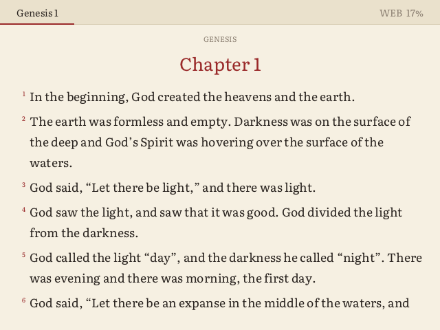
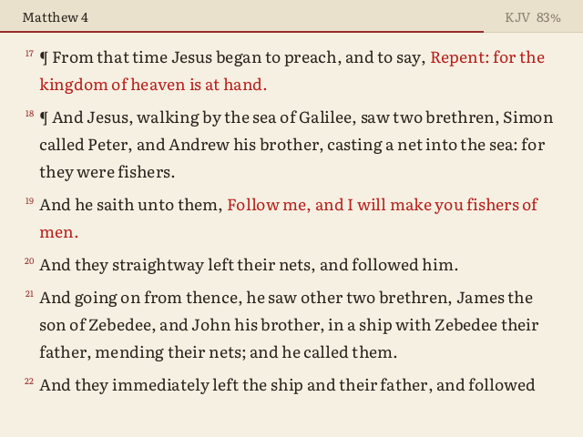
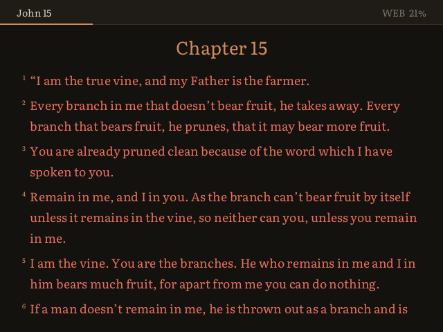
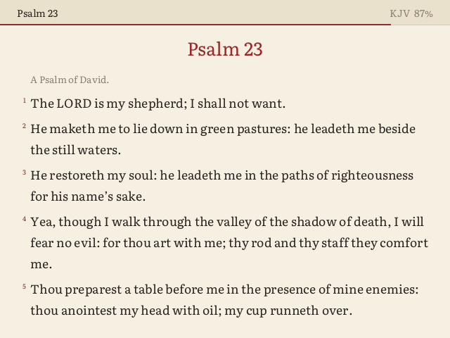
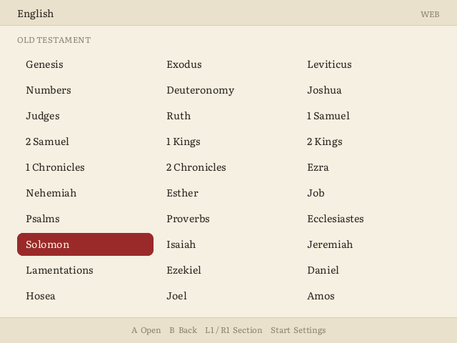
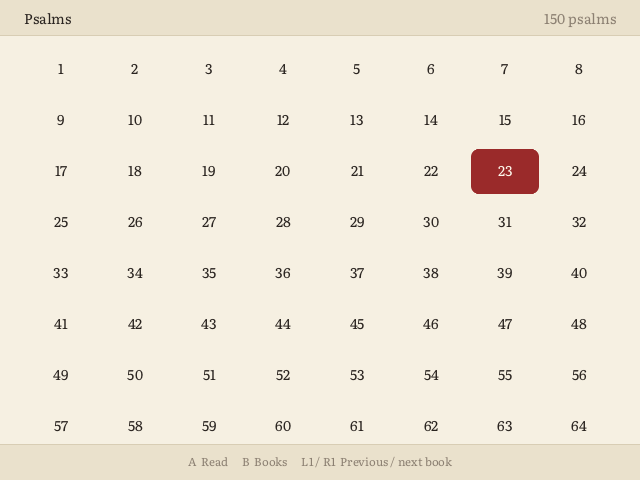
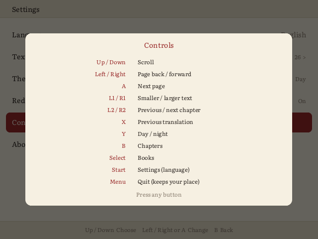

# Bible for Miyoo Mini

A native Bible reader for the **Miyoo Mini / Mini Plus on Onion OS**. It has real button controls, two translations, red letters, a night mode, and it remembers your place.



It doesn't use the terminal or need extra libraries. It's one small program that draws straight to the screen and reads the buttons directly.

## Features

- **King James Version** and **World English Bible**, switchable with one button. Switching keeps you on the same verse.
- **Red letters**: the words of Jesus in red, in both translations.
- **Day and night themes**, with 10 text sizes.
- **Resumes where you left off**, down to the verse.
- Book list and chapter grid for fast jumping.
- Psalm titles and Psalm 119's Hebrew letter headings are shown as headings.

| Red letters | Night | Psalms |
|---|---|---|
|  |  |  |

| Books | Chapters | Controls |
|---|---|---|
|  |  |  |

## Install

1. Download `Bible-x.y.z.zip` from [Releases](../../releases).
2. Extract it to the **root of your SD card**. You'll get `App/Bible/`.
3. On the Miyoo, open **Apps → Bible**.

## Controls

**Reading**

| Button | Action |
|---|---|
| Up / Down | Scroll (hold to keep scrolling) |
| Left / Right | Page back / forward |
| A | Next page; at the end of a chapter it rolls into the next one |
| L1 / R1 | Smaller / larger text |
| L2 / R2 | Previous / next chapter |
| X | Switch KJV / WEB |
| Y | Day / night |
| B | Chapter grid |
| Select | Book list |
| Start | Controls help |
| Menu | Quit (your place is saved) |

**Book list and chapter grid:** use the D-pad to move, A to open and B to go back. On the book list, L1 / R1 jump to the Old / New Testament. On the chapter grid, they go to the previous / next book.

Menu only quits when you tap it on its own, so Onion's Menu + button shortcuts keep working.

## Theme icons

The app ships with a white line icon. Matching icons for **Analogue**, **Hello Miyoo** and **NEON.ion** are in [`extras/theme-icons`](extras/theme-icons). To install one, copy that theme's `icons/app/bible.png` into the matching folder under `Themes/` on your card.

## Compatibility

- Tested on the **Miyoo Mini Plus** and **Miyoo Mini v3** with Onion OS.
- The 752×560 screen (Mini v4) is supported in layout, but hasn't been tested on hardware yet.
- Reports from other models are welcome.

## Building

This needs [Zig 0.14](https://ziglang.org/download/), which cross-compiles a static ARM binary with no Miyoo toolchain.

```powershell
.\build.ps1 -Version 1.0.0            # app\Bible\bible + dist\Bible-1.0.0.zip
.\build.ps1 -Version 1.0.0 -Preview   # also bible_preview.exe
```

`bible_preview.exe` runs the same code on a PC. Run it from inside `app\Bible` with button names as arguments, e.g. `..\..\bible_preview.exe select down a`. It writes one PNG per button press to `frames\`, which is how the screenshots above were made.

The text in `app/Bible/data` is generated from eBible.org's USFM files ([eng-kjv](https://ebible.org/find/details.php?id=eng-kjv), [engwebp](https://ebible.org/find/details.php?id=engwebp)):

```
python tools/make_data.py <booklist.txt> app/Bible/data kjv=<eng-kjv usfm dir> web=<engwebp usfm dir>
```

## Credits

- Bible texts: **King James Version** and **World English Bible**, both public domain, from [eBible.org](https://ebible.org). The KJV is under Crown Letters Patent in the United Kingdom.
- Font: [Literata](https://github.com/googlefonts/literata), SIL Open Font License 1.1.
- [stb_truetype / stb_image_write](https://github.com/nothings/stb) by Sean Barrett, public domain / MIT.
- Inspired by [Bible.sh](https://github.com/likeich/bible-sh), the terminal Bible app for Onion.

## License

The MIT license covers the reader's code; see [LICENSE](LICENSE). The bundled font and texts keep their own terms, listed there.
