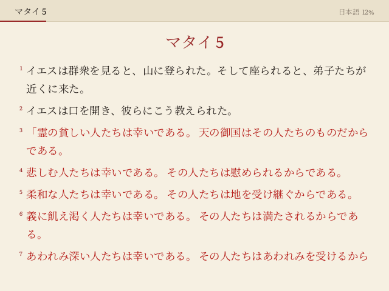
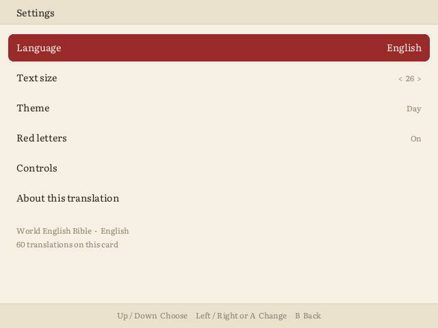
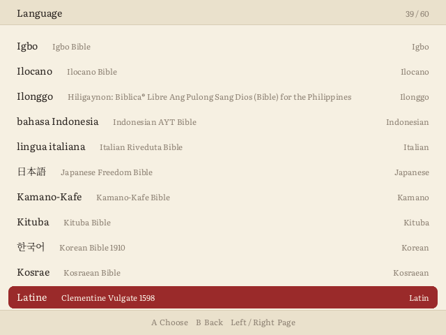
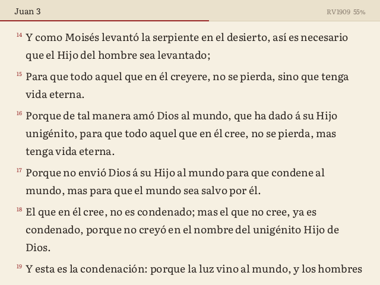

# Bible for Miyoo Mini

A native Bible reader for the **Miyoo Mini / Mini Plus on Onion OS**. It has real button controls, **60 translations in 60 languages**, red letters, a night mode, and it remembers your place.


It doesn't use the terminal or need extra libraries. It's one small program that draws straight to the screen and reads the buttons directly.

## Features

- **Adjustable text size**: L1 / R1 change it (10 sizes), and you stay on the verse you were reading.
- **60 languages**, including English (KJV and WEB), Spanish (Reina-Valera 1909), Latin (Clementine Vulgate with its deuterocanonical books), French, German, Italian, Portuguese, Russian, Esperanto, Vietnamese, **Japanese, Chinese and Korean**, and many more. See the [full list](#translations).
- **Red letters**: the words of Jesus in red, in every translation that marks them (24 of the 60). They can be turned off in Settings.
- **Real button controls**, with no terminal or on-screen keyboard.
- **Day and night themes**.
- **Resumes where you left off**, down to the verse, and X flips back to the translation you were reading before.
- Book names come from each translation, so the book list reads Génesis, Бытие, 創世記 and so on.

| Red letters | Night | Japanese |
|---|---|---|
|  |  |  |

| Settings | Language | Spanish |
|---|---|---|
|  |  |  |

| Books | Chapters | Controls |
|---|---|---|
|  |  |  |

## Install

From [Releases](../../releases), download one of:

| Download | Contents | Size |
|---|---|---|
| `Bible-x.y.z.zip` | English only: KJV and WEB | about 4 MB |
| `Bible-International-x.y.z.zip` | All 60 translations | about 85 MB zipped, 290 MB on the card |

1. Extract it to the **root of your SD card**. You'll get `App/Bible/`.
2. On the Miyoo, open **Apps → Bible**.

**Updating from 1.0:** extract over the old version. Your place is kept. To free space, you can delete the leftover `App/Bible/data/kjv` and `App/Bible/data/web` folders.

**Saving space:** each translation is a folder in `App/Bible/data/`. Delete any you don't want and the app simply won't list them.

## Controls

**Reading**

| Button | Action |
|---|---|
| Up / Down | Scroll (hold to keep scrolling) |
| Left / Right | Page back / forward |
| A | Next page; at the end of a chapter it rolls into the next one |
| L1 / R1 | Smaller / larger text |
| L2 / R2 | Previous / next chapter |
| X | Back to the previous translation |
| Y | Day / night |
| B | Chapter grid |
| Select | Book list |
| Start | Settings |
| Menu | Quit (your place is saved) |

**Settings:** Start opens it from the reader, the book list or the chapter grid. It has Language, Text size, Theme, Red letters, Controls and About this translation (copyright and license).

**Book list and chapter grid:** use the D-pad to move, A to open and B to go back. On the book list, L1 / R1 jump between sections (Old Testament, New Testament, and extra books where a translation has them). On the chapter grid, they go to the previous / next book.

Menu only quits when you tap it on its own, so Onion's Menu + button shortcuts keep working.

## Theme icons

The app ships with a white line icon. Matching icons for **Analogue**, **Hello Miyoo** and **NEON.ion** are in [`extras/theme-icons`](extras/theme-icons). To install one, copy that theme's `icons/app/bible.png` into the matching folder under `Themes/` on your card.

## Compatibility

- Tested on the **Miyoo Mini Plus** and **Miyoo Mini v3** with Onion OS.
- The 752×560 screen (Mini v4) is supported in layout, but hasn't been tested on hardware yet.
- Reports from other models are welcome.

## Translations

All texts come from [eBible.org](https://ebible.org). Only public domain and Creative Commons licenses that allow adaptation (BY, BY-SA, BY-NC) are included, because footnotes and cross references are removed. Each translation's folder holds a `LICENSE.txt` with its copyright, and the app shows it under **Settings → About this translation**.

Languages that need complex text shaping (Hindi, Bengali, Thai, Burmese and others) aren't included yet.

<details>
<summary>All 60 translations</summary>

| Language | | Translation | License |
|---|---|---|---|
| Aruamu | Aruamu | [Aruamu Bible](https://ebible.org/find/details.php?id=msy2020) | CC BY-SA |
| Beami | Bedamuni | [Bedamuni Bible](https://ebible.org/find/details.php?id=beo) | CC BY-SA |
| Belarusian | Belarusian | [Belarusan Bible, A. Boken](https://ebible.org/find/details.php?id=bel) | CC BY-NC |
| Cebuano | Cebuano | [Cebuano: Biblica® Open Ang Pulong sa Dios (Bible)](https://ebible.org/find/details.php?id=cebocb) | CC BY-SA |
| Chichewa | Chichewa | [Chichewa Bible](https://ebible.org/find/details.php?id=nya) | CC BY-SA |
| Chin, Eastern Khumi | Asang Khongca | [Asang Khongca Bible](https://ebible.org/find/details.php?id=cekak) | Public domain |
| Chin, Matu | Matupi Chin | [Matupi Chin Standard Bible w/ Strongs](https://ebible.org/find/details.php?id=hlt) | Public domain |
| Chin, Thado | Chongthu | [Chongthu Bible](https://ebible.org/find/details.php?id=tczchongthu) | CC BY-SA |
| Chin, Thaiphum | Thai Phum | [Thai Phum Bible](https://ebible.org/find/details.php?id=cth) | CC BY-SA |
| Chinese, Mandarin | 中国语文 | [World Chinese Bible](https://ebible.org/find/details.php?id=cmnswcb) | Public domain |
| chiShona | chiShona | [Shona Bible](https://ebible.org/find/details.php?id=sna) | CC BY-SA |
| Czech | český | [Czech Kralická Bible 1613](https://ebible.org/find/details.php?id=ces1613) | Public domain |
| Dawro | Dawro | [The Holy Bible in the Dawuro language of Ethiopia, Latin script](https://ebible.org/find/details.php?id=dwrl) | CC BY-SA |
| Dholuo | Dholuo | [Dholuo Bible](https://ebible.org/find/details.php?id=luo) | CC BY-SA |
| Dutch | Nederlands | [Dutch Bible 1917](https://ebible.org/find/details.php?id=nld) | Public domain |
| English | English | [King James Version](https://ebible.org/find/details.php?id=eng-kjv) | Public domain |
| English | English | [World English Bible](https://ebible.org/find/details.php?id=engwebp) | Public domain |
| Esperanto | Esperanto | [Esperanto Bible](https://ebible.org/find/details.php?id=epo) | Public domain |
| eʋegbe | eʋegbe | [Éwé Bible](https://ebible.org/find/details.php?id=ewe) | CC BY-SA |
| French | français | [French Louis Segond 1910 Bible](https://ebible.org/find/details.php?id=fraLSG) | Public domain |
| Gamo | Gamotso | [Gamo Bible (Latin)](https://ebible.org/find/details.php?id=gmvl) | CC BY-SA |
| German, Standard | Deutsch | [German Luther Bible 1912](https://ebible.org/find/details.php?id=deu1912) | Public domain |
| Gikuyu | Kikuyu | [Kikuyu Bible](https://ebible.org/find/details.php?id=kik) | CC BY-SA |
| Gofa | Goofa | [Gofa Bible Latin](https://ebible.org/find/details.php?id=gofl) | CC BY-SA |
| gujii | gujii | [Guji Oromo Bible](https://ebible.org/find/details.php?id=gax) | CC BY-SA |
| Haitian | Kreyòl Ayisyen | [Haitian Creole Bible 1985](https://ebible.org/find/details.php?id=hat) | Public domain |
| Hausa | Hausa | [Hausa Contemporary Bible](https://ebible.org/find/details.php?id=hausa) | CC BY-SA |
| Hawaiian | 'Olelo Hawai'i | [Hawaiian Bible 1868](https://ebible.org/find/details.php?id=haw1868) | Public domain |
| Igbo | Igbo | [Igbo Bible](https://ebible.org/find/details.php?id=ibo) | CC BY-SA |
| Ilocano | Ilocano | [Ilocano Bible](https://ebible.org/find/details.php?id=iloulb) | CC BY-SA |
| Ilonggo | Ilonggo | [Hiligaynon: Biblica® Libre Ang Pulong Sang Dios (Bible) for the Philippines](https://ebible.org/find/details.php?id=hil) | CC BY-SA |
| Indonesian | bahasa Indonesia | [Indonesian AYT Bible](https://ebible.org/find/details.php?id=indayt) | CC BY-NC |
| Italian | lingua italiana | [Italian Riveduta Bible](https://ebible.org/find/details.php?id=ita1927) | Public domain |
| Japanese | 日本語 | [Japanese Freedom Bible](https://ebible.org/find/details.php?id=jpnm) | Public domain |
| Kamano | Kamano-Kafe | [Kamano-Kafe Bible](https://ebible.org/find/details.php?id=kbq) | CC BY-SA |
| Kituba | Kituba | [Kituba Bible](https://ebible.org/find/details.php?id=mkw) | CC BY-SA |
| Korean | 한국어 | [Korean Bible 1910](https://ebible.org/find/details.php?id=kor) | Public domain |
| Kosraean | Kosrae | [Kosraean Bible](https://ebible.org/find/details.php?id=kos) | Public domain |
| Latin | Latine | [Clementine Vulgate 1598](https://ebible.org/find/details.php?id=latVUC) | Public domain |
| Lingála | Lingála | [Lingala Bible](https://ebible.org/find/details.php?id=lin) | CC BY-SA |
| Luganda | Luganda | [Luganda Bible](https://ebible.org/find/details.php?id=lug) | CC BY-SA |
| Malagasy, Tandroy-Mahafaly | Tandroy | [Tandroy Bible](https://ebible.org/find/details.php?id=tdx) | CC BY-SA |
| Māori | Māori | [Maori: Paipera Tapu 2012 (Bible)](https://ebible.org/find/details.php?id=mri2012) | CC BY-NC |
| Ndebele | isiNdebele | [Ndebele Bible](https://ebible.org/find/details.php?id=nde) | CC BY-SA |
| Oromo, West Central | Afaan Oromoo | [New Oromo Contemporary Version](https://ebible.org/find/details.php?id=gaz) | CC BY-SA |
| Portuguese | Português | [World Portuguese Bible](https://ebible.org/find/details.php?id=porbrbsl) | Public domain |
| Romanian | Romanian | [Romanian Bible (Cyrillic)](https://ebible.org/find/details.php?id=ron1924) | Public domain |
| Russian | русский | [Russian Synodal Bible](https://ebible.org/find/details.php?id=russyn) | Public domain |
| Serbian | srpski jezik | [Serbian DK Bible (Latin)](https://ebible.org/find/details.php?id=srp1865) | Public domain |
| Shi | Mashi | [Mashi Bible](https://ebible.org/find/details.php?id=shr) | CC BY |
| Spanish | Español | [Reina Valera 1909](https://ebible.org/find/details.php?id=spaRV1909) | Public domain |
| Swahili | Kiswahili | [Kiswahili Contemporary Version](https://ebible.org/find/details.php?id=swhonen) | CC BY-SA |
| Tagalog | Tagalog | [Tagalog Bible](https://ebible.org/find/details.php?id=tglulb) | CC BY-SA |
| Tongan | Tongan | [Revised West Version](https://ebible.org/find/details.php?id=ton) | Public domain |
| Twi | Akuapem Twi | [Akuapem Twi Bible](https://ebible.org/find/details.php?id=twi) | CC BY-SA |
| Ukrainian | Українська | [Ukrainian Bible by P. Kulish](https://ebible.org/find/details.php?id=ukr1871) | Public domain |
| Uyghur | Uyghur tili | [Uyghur Bible (cyrillic script)](https://ebible.org/find/details.php?id=uigcyr) | CC BY-SA |
| Vietnamese | Tiếng Việt | [Vietnamese Bible 1923](https://ebible.org/find/details.php?id=vie1934) | Public domain |
| Wolof | Wolof | [Wolof Bible (MBS)](https://ebible.org/find/details.php?id=wolmbs) | CC BY-NC |
| Yorùbá | Yorùbá | [Yoruba Bible](https://ebible.org/find/details.php?id=yor) | CC BY-SA |

</details>

## Building

This needs [Zig 0.14](https://ziglang.org/download/), which cross-compiles a static ARM binary with no Miyoo toolchain, and Python with `pymupdf` and `fonttools` for the text.

1. **Build the text.** [`tools/selection.json`](tools/selection.json) lists the translations. Download each one's USFM zip (`https://ebible.org/Scriptures/<id>_usfm.zip`) and unpack it into `<usfm root>/<id>/`. Then run:

   ```
   python tools/make_data.py tools/selection.json <usfm root> app/Bible/data app/Bible/Literata.ttf app/Bible/NotoSerif.ttf <cjk font dir>
   ```

   `<cjk font dir>` holds `NotoSerifJP.ttf`, `NotoSerifSC.ttf` and `NotoSerifKR.ttf`, plus their `_OFL.txt` files, from [google/fonts](https://github.com/google/fonts/tree/main/ofl). The script trims each one down to the characters its Bible uses.

2. **Build the app and the zips:**

   ```powershell
   .\build.ps1 -Version 1.1.0            # app\Bible\bible + both zips in dist\
   .\build.ps1 -Version 1.1.0 -Preview   # also bible_preview.exe
   ```

`bible_preview.exe` runs the same code on a PC. Run it from inside `app\Bible` with button names as arguments, e.g. `..\..\bible_preview.exe start a down a`. It writes one PNG per button press to `frames\`, which is how the screenshots above were made.

## Credits

- Bible texts from [eBible.org](https://ebible.org); see each translation's `LICENSE.txt`. The KJV is under Crown Letters Patent in the United Kingdom.
- Fonts: [Literata](https://github.com/googlefonts/literata) and [Noto Serif / Noto Serif JP, SC, KR](https://github.com/notofonts), all under the SIL Open Font License 1.1.
- [stb_truetype / stb_image_write](https://github.com/nothings/stb) by Sean Barrett, public domain / MIT.
- Inspired by [Bible.sh](https://github.com/likeich/bible-sh), the terminal Bible app for Onion.

## License

The MIT license covers the reader's code; see [LICENSE](LICENSE). The bundled fonts and texts keep their own terms, listed there.
